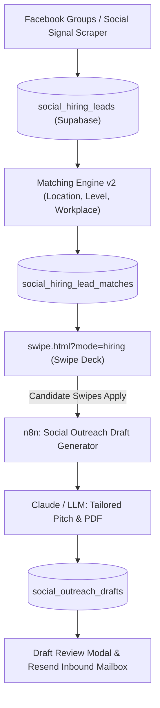

# Social Hiring (Social Posts — Auto Outreach) — Comprehensive Progress Log

> **Feature Scope:** End-to-end recruiter & social hiring post discovery, automated matching, AI outreach email drafting, tailored ATS-resume generation, founder fraud filtering, and credit monetization.

---

## 1. Executive Summary & Core Architecture

Social Hiring transforms unstructured recruiter posts (Facebook groups, LinkedIn/X hiring posts) into high-intent candidate outreach opportunities. Instead of submitting repetitive ATS portal forms, RoleRover generates a personalized, high-converting plain-text email with a tailored ATS resume attached, sending it directly through the candidate's dedicated Rover mailbox (`@myrolerover.com`).

---

## 2. Named Workflows (n8n & Background Services)

The Social Hiring ecosystem is driven by the following dedicated workflows:

| Workflow Name | n8n ID | Status | Role & Functionality |
| :--- | :--- | :--- | :--- |
| **Social Outreach Draft Generator** | `47iMywpBbvAVbyB9` | **ACTIVE** | Triggered on swipe apply. Takes candidate profile + social post details, generates a high-converting, human plain-text email pitch (no AI self-reference / no robotic fluff), and pairs it with the candidate's tailored ATS resume. |
| **Social Hiring Signal Scraper** | `AEzEs5bufc7EgSZW` | Scheduled | Automated scraper scanning target Facebook groups for verified recruiter posts, contact emails, workplace types, and country requirements. |
| **Matching v2: Jev location check** | `93vUULA5aodg7dDm` | **ACTIVE** | Evaluates geographic fit (ISO country matching vs free text), workplace preferences (Remote / Hybrid / Onsite), and level tolerance (±1 level rank). |
| **Resend Inbound Bridge** | `8slgeCUYgO4EoC6r` | **ACTIVE** | Connects candidate's dedicated Rover mailbox (`Application_email`) with Resend, capturing inbound recruiter replies and tracking conversational threads. |
| **RoleRover Redraft API** | `1vR9LaTegnKQQaE6` | **ACTIVE** | On-demand redrafting endpoint when candidates request edits or adjustments to the email body. |
| **Facebook GTM - Group Search Result** | `99wzNRlaI8W8Vwf0` | **ACTIVE** | GTM and search lead ingestion validation for social group posts. |
| **Hiring Manager Outreach — Find & Draft** | `D1KB6lbkLvuYlPZN` | Reference | Auxiliary pipeline for finding decision-maker contacts and initiating outreach. |

---

## 3. What Was Received (Original Base Scope)

When the task was received, Social Hiring existed as an early prototype with several critical UX, data, and flow gaps:
1. **Uncertain Naming**: Labeled inconsistently across the app as "Hiring Posts", "Job Deck", or "Social Leads".
2. **Missing PDF Attachments & 404 Errors**: Clicking tailored PDF attachments resulted in JSON `NoSuchKey` (404) errors in Supabase storage.
3. **Robotic Email Drafts**: Drafts generated with internal model references ("As Claude/Llama...", "Pure Plain Text Email · Zero HTML formatting" banners, and emojis in system notifications).
4. **False Safety Badges**: Unnamed companies on social posts still showed generic `"Verified: No scam reports found"`, misleading users.
5. **No Monetization / Free Tier Distinction**: Free users had unrestricted access without a conversion barrier.
6. **Cluttered Navigation**: Three flat tabs at the top of every page caused confusion between corporate ATS jobs and social hiring leads.

---

## 4. What Was Added & Implemented (Additions & Refinements)

### A. Navigation & Hierarchy Architecture
* **Single Career Pages Entry in Sidebar**:
  - `🏢 Career Pages [158]`: Single expandable parent folder item in the sidebar.
  - Sub-links cleanly indented underneath:
    - `⚡ Auto-Apply` (`swipe.html`)
    - `📄 Apply Yourself (Free)` (`jobs.html`)
  - No duplicate "Career Pages" buttons anywhere in the sidebar.
* **Dedicated Social Hiring Navigation**:
  - `📱 Social Posts — Auto Outreach [40]`: Sits directly beneath Career Pages with a distinct green count badge.
* **Cleaned Page Headers**:
  - Completely removed the redundant double-row pill switcher (`[Career Pages (158)] [Social Posts (40)] Mode: [Auto-Apply] [Apply Yourself]`) from `swipe.html`, `dashboard.html`, and `jobs.html`.
  - Headers now display a clean, focused title: **`Career Pages`** or **`Social Posts — Auto Outreach`**.

### B. Accurate Total Jobs Stat Bar
* **Headline Metric**: `TOTAL JOBS FOUND: 198`
* **Subtext Breakdown**: `158 Career Pages · 40 Social Posts`
* Shared job count logic ensures the 158 corporate jobs are never falsely double-counted across manual and automated modes.

### C. Draft View & Attachment Overhaul
* **ATS Resume Naming Convention**:
  - Changed arbitrary storage keys to standard professional naming: `${firstName}_${lastName}_${safeTitle}.pdf` (e.g., `Musa_Musa_Senior_Frontend_Engineer.pdf`).
  - Removed confusing tag `(Tailored PDF Attached)` from the UI.
* **Fail-Safe PDF Fallback**:
  - Implemented `handleDraftResumeClick()`: If the tailored PDF is still generating or returns a 404 from storage, it instantly falls back to the candidate's verified master resume (`userProfile.master_resume`), preventing broken JSON error screens.
* **Honest Fraud & Identity Badges**:
  - When employer is unnamed in a social post: Displays initials `NC` + `NO COMPANY NAME ON POST`.
  - Verification badge honestly reads: `Employer not named · verify before applying` (never falsely claiming "No scam reports found").
* **Editorial Polish**:
  - Removed emojis from system toast notifications (e.g., `Tailoring your application draft...`).
  - Removed the `Pure Plain Text Email · Zero HTML formatting` banner; promoted `Edit text` to the top action row.

### D. Free Tier Paywall & Monetization Gate
* **5-Post Free Cap**: Free trial users can review and apply to their first 5 social posts.
* **Dynamic Paywall Card (#6)**: Post #6 renders a dynamic upgrade card:
  - Headline: `🔥 40 New Social Posts Found Waiting For You!`
  - Direct conversion trigger prompting upgrade to Premium.

### E. Layout & Stability Bug Fixes
* **Resolved `swipe.html` Syntax Error**: Eliminated accidental duplicate `const isHiring` declaration that halted script initialization.
* **Resolved `jobs.html` Flex Collapse**: Removed two stray closing `
` tags that had prematurely closed `<header>` and `.app-main`, restoring full-width centered layout.
* **Fixed Sidebar Active Styling**: Eliminated solid black `#000` background bug on the parent `Career Pages` item in `jobs.html`.

---

## 5. Database Schema & State Tracking

Social Hiring operates across the following primary Supabase entities:

1. **`social_hiring_leads`**:
   - `id`, `platform`, `post_url`, `post_text`, `author_name`, `company_name`, `contact_email`, `fraud_check_status`, `detected_job_level`, `detected_countries`, `detected_workplace_type`, `says_anywhere`, `status`.
2. **`social_hiring_lead_matches`**:
   - `profile_id`, `lead_id`, `decision` (`pending` / `applied` / `declined` / `skipped`), `fit_reason`, `fit_missing_skills`.
3. **`social_outreach_drafts`**:
   - `match_id`, `recipient_email`, `subject`, `body_text`, `resume_storage_path`, `status` (`draft` / `approved` / `sent`).
4. **`profiles`**:
   - `social_free_sends_used`: Tracks free-tier quota (limit 5).

---

## 6. Git Commit Trail (Deployments to `main`)

| Commit | Description |
| :--- | :--- |
| `39ab032` | ATS resume naming, honest scam checks, fail-safe PDF handler, 5-post free paywall |
| `1b5224a` | Standardized naming across Career Pages and Social Posts |
| `12de9f3` | Resolved duplicate `const isHiring` declaration in `swipe.html` |
| `4e65c9d` | Single Career Pages sidebar folder with Auto-Apply & Apply Yourself sub-links |
| `bdd51c6` | Removed redundant header toggle pills; streamlined page title |
| `861491d` | Fixed stray closing `
` tags and active sidebar CSS in `jobs.html` |

---
*Log generated on 2026-10-29. RoleRover Social Hiring feature is fully live on [myrolerover.com/swipe.html?mode=hiring](https://myrolerover.com/swipe.html?mode=hiring).*
